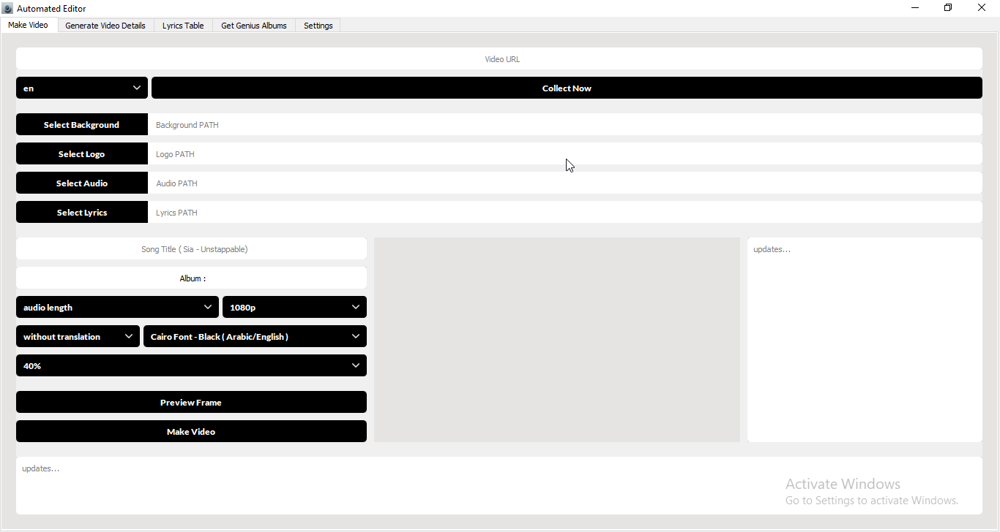
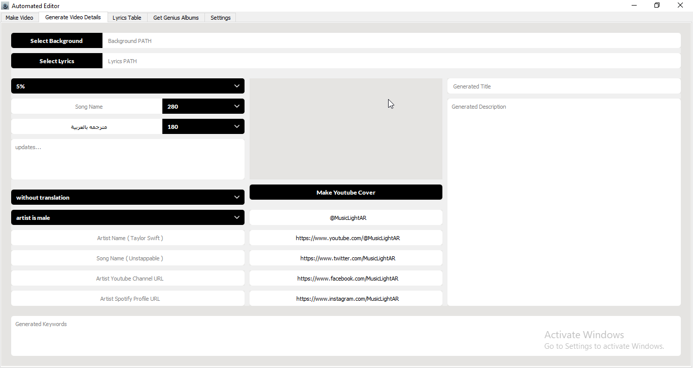
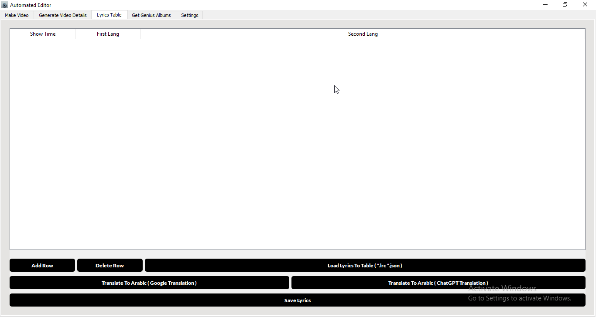
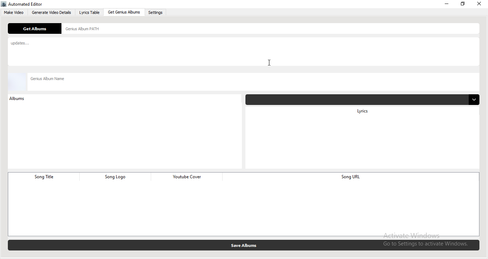

# 🎵 AI Song Translation Video Generator

A desktop GUI application designed specifically for translating songs into different languages and automatically generating customized videos from YouTube URLs.

The program uses **OpenAI** and **Google Translate (free)** to translate song lyrics, helping users create multilingual song videos with customizable settings.

## ✨ Features

- 🎬 **YouTube URL Support** — Generate videos from YouTube video links.
- 🌍 **Multilingual Translation** — Translate song lyrics into different languages.
- 🤖 **OpenAI Integration** — Use OpenAI models for AI-powered lyric translation.
- 🔤 **Google Translate Integration** — Translate lyrics using the free Google Translate service.
- 🎨 **Customizable Video Settings** — Configure video generation according to your preferences.
- 🖥️ **Desktop GUI** — Manage the workflow through a graphical user interface.
- 🎵 **Song-Focused Workflow** — Designed specifically for translating songs rather than general-purpose video translation.
- ⚙️ **Automated Generation** — Streamline the process of creating translated song videos.

## 📸 Screenshots

Screenshots of the application's interface

*Main application interface*

*Video generation details and settings*

*Song translation into different languages*

*Extracting albums and song information from Genius*

## 🎬 Example Generated Video

Watch an example of a video generated using this program:

